  

  

  

  
 About me

Hi! I'm a developer at Nabla Lab, an IT company that does software development and IT infrastructure. I build desktop and web applications on C# / .NET, design databases and turn business processes into working software. And when a project needs someone to bring the team together, set priorities and talk to people, that's me too.

csharp
var emil = new Developer
{
    Company    = "Nabla Lab",   // software development & IT infrastructure
    Roles      = ["Developer", "Project manager", "Analyst"],
    Builds     = ["Desktop apps", "Web apps", "Databases", "Business processes"],
    Paradigms  = ["OOP", "Functional programming"],
    Superpower = "Interfaces that feel human",
};

await emil.ShipAsync();
<table> <tr> <td width="33%" valign="top">
 Development
Desktop apps in C#: WPF, WinForms, Qt
Web apps on ASP.NET MVC / Core, Angular, React
Containers with Docker, Linux tooling via WSL
UI/UX: clear, user-friendly, human interfaces
</td> <td width="33%" valign="top">
 Data & Processes
Database architecture design
Business process modeling in BPMN
Analytics with Power BI, Excel VBA, RapidMiner
</td> <td width="33%" valign="top">
 Management
Project management
Organizing and coordinating developers in the team
Social media administration and community communication
</td> </tr> </table>  
 Tech stack

     
 
       
  
 GitHub stats

   
 
  
 
 <picture> <source media="(prefers-color-scheme: dark)" srcset="./profile/snake-dark.svg" /> <source media="(prefers-color-scheme: light)" srcset="./profile/snake-light.svg" />  </picture> 
  
 Projects
 Personal repositories
<table> <tr> <td align="center" valign="top" width="33%">   <b>Windows Forms</b>  Desktop      </td> <td align="center" valign="top" width="33%">   <b>Qt</b>  Desktop        </td> <td align="center" valign="top" width="33%">   <b>WPF</b>  Desktop      </td> </tr> <tr> <td align="center" valign="top" width="33%">   <b>ASP.NET</b>  Web            </td> <td align="center" valign="top" width="33%">   <b>Databases</b>  Data    </td> <td align="center" valign="top" width="33%">   <b>Console</b>  C# & C++          </td> </tr> </table>
 Nabla Lab
<table> <tr> <td align="center" valign="middle" width="40%">   <b><a href="https://nabla-lab.ru/">Nabla Lab</a></b>  IT company: software development and IT infrastructure     Built on <b>ASP.NET Core</b> </td> <td align="center" valign="middle" width="60%">            </td> </tr> </table>   
