  

 

##  About me

I build desktop and web applications on **C# / .NET**, design databases and turn business processes into working software. Beyond code, I organize development teams, keep projects on track and stay in touch with the communities around them.

<table>
<tr>
<td width="33%" valign="top">

###  Development

- Desktop apps in **C#**: WPF, WinForms, **Qt**
- Web apps on **ASP.NET MVC / Core**, **Angular**, **React**
- Containers with **Docker**, Linux tooling via **WSL**
- Functional & object-oriented programming
- UI/UX: clear, user-friendly, human interfaces

</td>
<td width="33%" valign="top">

###  Data & Processes

- Database architecture design
- Business process modeling in **BPMN**
- Analytics with **Power BI**, **Excel VBA**, **RapidMiner**

</td>
<td width="33%" valign="top">

###  Management

- Project management
- Organizing and coordinating developers in the team
- Social media administration and community communication

</td>
</tr>
</table>

 

##  Tech stack

  
   
  

  
  
  
  
  
  

 

##  GitHub stats

  
  

  

  <picture>
    <source media="(prefers-color-scheme: dark)" srcset="./profile/snake-dark.svg" />
    <source media="(prefers-color-scheme: light)" srcset="./profile/snake-light.svg" />
    
  </picture>

 

##  GitHub map

###  Personal repositories

-  **Windows Forms**
  - [Russian Test](https://github.com/Emil-Maksudov/RussianTest)
  - [Kurs Game](https://github.com/Emil-Maksudov/KursWork)
-  **Qt**
  - [Convertor](https://github.com/Emil-Maksudov/Convertor)
  - [Calculator](https://github.com/Emil-Maksudov/Calculator)
  - [Paint](https://github.com/Emil-Maksudov/PaintQT)
-  **WPF**
  - [Traficlight](https://github.com/Emil-Maksudov/Traficlight)
  - [RunLabel](https://github.com/Emil-Maksudov/RunLabel)
-  **ASP.NET**
  - [FRDZ School Web](https://github.com/Emil-Maksudov/FRDZ-School-Web)
  - [Valeronix](https://github.com/Emil-Maksudov/Valeronix)
  - [MaliLib](https://github.com/Emil-Maksudov/MaliLib)
  - [Faxr Hospital](https://github.com/Emil-Maksudov/FaxrHospital)
  - [AR Grace beauty](https://github.com/Emil-Maksudov/AR-Grace-beauty)
-  **Databases**
  -  [Future manual](https://github.com/dqrest/learning-data-base)
-  **Console**
  - [Work with matrix](https://github.com/Emil-Maksudov/WorkWithMatrix)
  - [Work with matrix C++](https://github.com/Emil-Maksudov/WorkWithMatrixC-)
  - [Cat vs Fish game](https://github.com/Emil-Maksudov/CatVSFish)
  - [Back-Track](https://github.com/Emil-Maksudov/BackTrack)

###  Nabla Lab

-  **ASP.NET Core**
  -  [NablaWeb](https://github.com/Leonid-Vizel/NablaWeb)
  -  [PVSystem](https://github.com/Leonid-Vizel/PVSystem)
  -  [NablaBuilder](https://github.com/Leonid-Vizel/NablaBuilder)
  -  [PTLV Service](https://github.com/Emil-Maksudov/KZM)
  -  [PDE Writing](https://github.com/Emil-Maksudov/pde-writing.ru)
  - [WebAnimalPassport](https://github.com/Leonid-Vizel/WebAnimalPassport)

 

